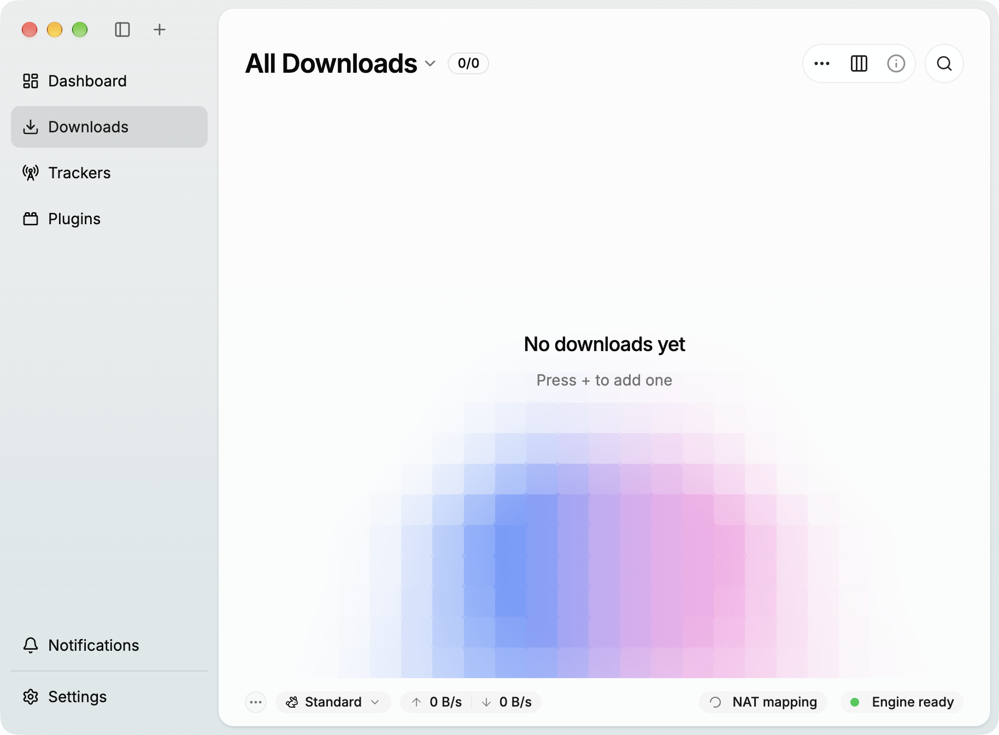
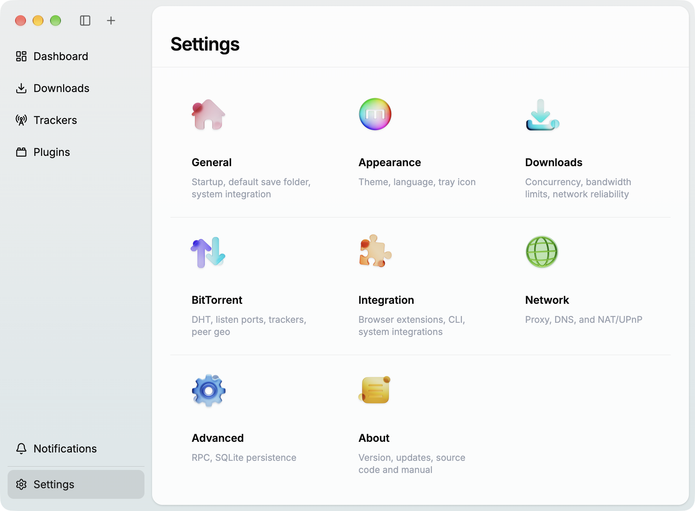

<div align="center">


# Motrix 2.4.2 · ED2K Edition

**A macOS 12-compatible Motrix fork with real eD2k downloading, original file names, and reciprocal sharing.**

[](#requirements)
[](https://github.com/agalwood/Motrix)
[](./ed2k-engine)
[](./LICENSE)
[](#verification)

English | [简体中文](./README.zh-CN.md)

</div>

---

## What this edition is

This is a focused fork of [agalwood/Motrix](https://github.com/agalwood/Motrix) v2.4.2 for macOS 12 Monterey. It keeps Motrix's desktop experience and adds the two things upstream does not provide: **ED2K link admission** and **an engine that actually speaks eD2k**.

It is not a reskin and it does not pretend a dead hash can download. The app parses the link, extracts its real file name, connects to eD2k servers and Kad, and writes the completed file under the name carried by the link.

> Independent community fork. Not affiliated with the Motrix upstream project, Microsoft, or Xunlei.

| Edition | macOS 12 | ED2K | Best for |
| --- | --- | --- | --- |
| [macOS 12 Edition](https://github.com/a2109246162-tech/motrix-macos12) | ✅ | ❌ | Monterey users who want the original Motrix feature set |
| **ED2K Edition** (this repo) | ✅ | ✅ | Monterey users who need ED2K links, sharing and contribution stats |

## What actually gets downloaded

An ED2K file link looks like this:

```
ed2k://|file|deepin-desktop-community-25.2.0-amd64.iso|6976131072|ED2B0112...|/
```

When you add it:

1. The link is validated and the **file name is extracted from the link itself**, then percent-decoded. It is not passed through `new URL()`, because an ED2K link is not a URL.
2. aria2-next receives the link and asks the connected server and Kad for sources with that hash.
3. The file is written as `<original-name>.motrix` while incomplete.
4. On completion it is verified, renamed to `<original-name>` and shown as a normal file in Downloads.

The name and extension are preserved. A test download of a 3.3 MB ED2K PDF produced:

```
[Wiley] Ubuntu Linux Toolbox 1000+ Commands for Ubuntu & Debian Power Users.pdf
PDF document, version 1.6
```

If a hash has no live sources, the task stays at **0 B/s with 0 peers**. That is the network, not a hidden speed cap. In testing, an old Deepin 20.5 hash had no sources, while Ubuntu 20.04 connected to 11 peers and downloaded at roughly 100–200 KB/s over a LowID connection.

## Features

| Feature | Status |
| --- | --- |
| ED2K file, server and serverlist links | Parsed and admitted through every Motrix layer |
| ED2K engine | Bundled `aria2-next 3.1.0` with eD2k/Kad support |
| Server and Kad bootstrap | `server.met` + `nodes.dat`, refreshed active-server list |
| Multi-threaded transfer | 16-way split, 200 eD2k connections, 1 MiB minimum split |
| Original file names | Extracted from the link, percent-decoded, extension preserved |
| Per-task sharing ratio | Right-click a task, choose 0–10× the file size with a slider |
| Global sharing switch | Settings → BitTorrent → ED2K 分享 |
| Contribution dashboard | Lifetime total, daily breakdown and top tasks |
| HTTP / HTTPS / FTP / BT / Magnet | Preserved from upstream |
| macOS 12 compatibility | Preserved from `motrix-macos12` |

## Screenshots

<p align="center">
  
</p>

<p align="center">
  
</p>

## Requirements

- macOS 12.0 or later (verified on macOS 12.7.6, Intel x64)
- An Intel Mac; this build is `x64`
- A network that permits eD2k traffic
- For better peer connectivity: a reachable TCP/UDP port

## Install

1. Download the four `.part-*` files from [Releases](../../releases).
2. Join them:

   ```bash
   cat Motrix-2.4.2-ed2k-macos12-x64.dmg.part-* \
     > Motrix-2.4.2-ed2k-macos12-x64.dmg
   ```

3. Open the DMG and drag **Motrix ED2K** into **Applications**.
4. On first launch, right-click the app and choose **Open** if Gatekeeper blocks it.

The build is ad-hoc signed, not notarized. Do not enable in-app auto-update; it would replace the patched engine and macOS 12 binaries.

## Use

### Add an ED2K file

Paste an `ed2k://|file|...|/` link into **New Task → Links**. The task is admitted only after the link, size and hash are validated.

### Share back

Open **Settings → BitTorrent → ED2K 分享** and keep **为 ED2K 资源提供带宽** enabled. Then right-click an ED2K task:

- **0** — stop uploading after the download completes
- **0.5** — default; upload 50% of the downloaded bytes
- **1–10** — upload 1× to 10× the file size
- **不限** — keep seeding without a ratio limit

For a 1 GB file, 0.5 means a 0.5 GB target, 1 means 1 GB, 10 means 10 GB. The monitor checks every 10 seconds, removes the engine task at the target, and keeps the downloaded file.

## Source availability and speed

eD2k is peer-to-peer. Speed depends on **live sources**, their upload bandwidth, and whether your client is reachable. Xunlei's higher speed comes from its own central cache and CDN; a public eD2k client cannot reproduce that.

Run the built-in diagnostic while the app is running:

```bash
python3 ed2k-engine/diagnose.py
```

It prints connected servers, LowID, Kad nodes, port mapping and per-task peer counts.

Measured on the development machine:

```
lowId: true
kadFirewalled: true
portMapping: off
connectedServerCount: 1
```

To improve the odds of HighID, forward **TCP 4662** and **UDP 4672** to the Mac's LAN address on the router. UPnP returned error 501 on the test router, so automatic mapping is disabled.

If a task reports `0 peers` for minutes, the hash is cold. Try a current link from eD2k search; do not expect a 2022 ISO to have seeders forever.

## Dashboard contribution

The transfer tile always shows **ED2K 已贡献 · 详情**, including when the total is 0 B. Click it to open:

- lifetime contributed bytes
- day-by-day totals
- the top tasks that received your upload each day

The counter is updated by the same 10-second monitor that enforces sharing ratios. It is stored in `ed2k-contribution.json` under the Motrix user-data directory and keeps 90 days of history.

## Names and finalization

Two details are easy to get wrong, and both are covered by regression tests:

- **Name**: `ed2kLinkFilename()` extracts and percent-decodes the name from the link. The create path uses it for the engine `out`, the `.motrix` temporary file and the final rename.
- **Finalization**: aria2-next reports `Could not remove download result of GID <gid>` without a `#`. The adapter accepts both that form and the older `GID#<gid>` form, then retries. Without this, a completed ED2K download stays stuck at `.motrix`.

## Architecture

```
Motrix renderer / main process
        │  ED2K admission + per-task sharing + contribution tracking
        ▼
  aria2-next 3.1.0
        │  eD2k + Kad protocol
        ▼
  server.met / nodes.dat / peers
```

The fork does not reimplement eD2k. It removes Motrix's protocol whitelist blocks, ships a native eD2k engine, bootstraps the network, preserves names, and adds sharing/contribution policy at the application layer.

## Build from source

```bash
corepack pnpm install --frozen-lockfile

corepack pnpm exec tsc --noEmit
corepack pnpm exec vitest run \
  src/shared/lib/ed2k-link.test.ts \
  src/shared/lib/download-source.test.ts \
  src/core/task/source-admission.test.ts \
  src/core/task/ed2k-sharing.test.ts \
  src/core/engine/aria2/feature-report.test.ts \
  src/core/task/create-task-handler.test.ts \
  src/core/engine/aria2/aria2-adapter.test.ts \
  src/renderer/routes/dashboard/tiles/transfer-tile.test.tsx

corepack pnpm run build:electron
corepack pnpm exec node scripts/stage-electron-app.mjs --platform darwin --arch x64
```

The engine lives in `ed2k-engine/`; see [`ed2k-engine/README.md`](./ed2k-engine/README.md).

## Verification

- 387 focused tests pass.
- `tsc --noEmit` passes.
- Biome checks pass on the changed files.
- End-to-end ED2K test: a 3.3 MB PDF completed, finalized under its original name, and `file` reports `PDF document, version 1.6`.
- Live-source test: Ubuntu 20.04 connected to 11 peers and downloaded at roughly 100–200 KB/s; a dead Deepin 20.5 hash stayed at 0 peers.
- App launches on macOS 12.7.6, aria2-next starts with server and Kad lists, and the task inspector labels ED2K tasks as `ED2K`.

## Known limitations

- eD2k speed cannot exceed available live sources; a cold hash can remain at 0 B/s in every open client.
- LowID limits incoming connections. Manual port forwarding is required for HighID on routers where UPnP fails.
- The bundled engine is GPL-2.0; the Motrix source and this fork's patches are MIT.
- macOS 12 login-item registration is inherited from the base compatibility patch and remains unavailable.
- The build is ad-hoc signed and not notarized.

## Credits and license

- Upstream: [agalwood/Motrix](https://github.com/agalwood/Motrix), MIT.
- macOS 12 base: [motrix-macos12](https://github.com/a2109246162-tech/motrix-macos12).
- eD2k engine: [aria2-next](https://github.com/AnInsomniacy/aria2-next), GPL-2.0.
- Server/Kad data: `upd.emule-security.org` and the Telemacore active-server list.

See [`LICENSE`](./LICENSE), [`ATTRIBUTION.md`](./ATTRIBUTION.md), and [`THIRD_PARTY_NOTICES.md`](./THIRD_PARTY_NOTICES.md).
