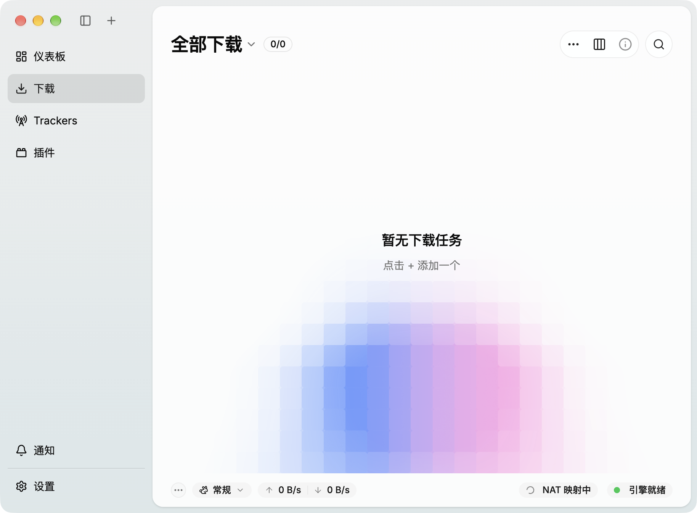
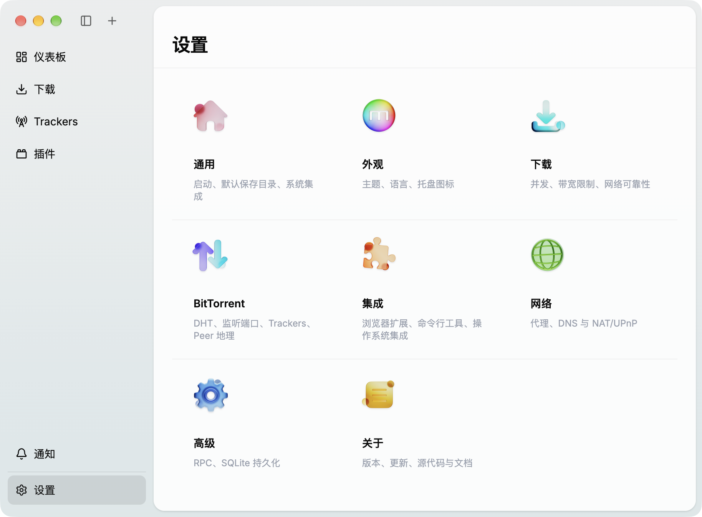

<div align="center">


# Motrix 2.4.2 · ED2K 版

**兼容 macOS 12 的 Motrix 分支：原生识别 ED2K、内置 aria2-next 引擎，并按任务回馈分享流量。**

[](#系统要求)
[](./LICENSE)
[](./ed2k-engine)
[](#验证)

[English](./README.md) | 简体中文

</div>

---

## 项目简介

本项目基于 [agalwood/Motrix](https://github.com/agalwood/Motrix) v2.4.2，保留 Motrix 的桌面体验，补上上游没有提供的两件事：**ED2K 链接准入** 和 **真正支持 eD2k 的下载引擎**。

它面向 macOS 12 Monterey——很多 Intel Mac 能运行的最后一个 macOS 大版本。原版 2.4.2 在这里无法启动；本分支保留 macOS 12 兼容补丁，并在其上增加 ED2K 支持。

> 这是独立的社区分支，与 Motrix 上游、Microsoft、迅雷均无隶属关系。

## 功能

| 功能 | 状态 |
| --- | --- |
| ED2K 文件、服务器、服务器列表链接 | 通过 Motrix 各层准入并解析 |
| ED2K 引擎 | 内置 `aria2-next 3.1.0`，原生支持 eD2k/Kad |
| 服务器与 Kad 引导 | `server.met` + `nodes.dat`，附带活跃服务器列表 |
| 多线程传输 | 16 分块、200 个 eD2k 连接、最小分块 1 MiB |
| 每任务分享比例 | 右键任务，用滑轨选择 0–10 倍文件大小 |
| 全局分享开关 | 设置 → BitTorrent → ED2K 分享 |
| HTTP / HTTPS / FTP / BT / Magnet | 保留上游能力 |
| macOS 12 兼容 | 保留 `motrix-macos12` 补丁 |

## 界面

<p align="center">
  
</p>

<p align="center">
  
</p>

## 系统要求

- macOS 12.0 或更高（已在 macOS 12.7.6、Intel x64 实测）
- 允许 eD2k 流量出站的网络
- 想要更好的 eD2k 速度：需要可达的 TCP/UDP 端口（见[网络与速度](#网络与速度)）

## 安装

1. 从 [Releases](../../releases) 下载 `Motrix-2.4.2-ed2k-macos12-x64.dmg`。
2. 打开 DMG，把 **Motrix ED2K** 拖进「应用程序」。
3. 首次启动如被 Gatekeeper 拦截，右键应用选择「打开」。

本构建使用 ad-hoc 签名，未做公证。不要开启应用内自动更新，否则会覆盖补丁。

## 使用

### 下载 ED2K 文件

把 `ed2k://|file|...|/` 链接粘贴到 **新建任务 → 链接**。应用会校验 hash 与大小、接受任务并交给 aria2-next。

### 回馈分享

打开 **设置 → BitTorrent → ED2K 分享**，保持 **为 ED2K 资源提供带宽** 开启。然后右键任意 ED2K 任务：

- 滑轨 **0**：下载完成后停止上传
- 滑轨 **0.5**：默认值，上传下载量的 50%
- 滑轨 **1–10**：上传文件大小的 1 到 10 倍
- **不限**：不设比例上限，一直做种

例如 1 GB 文件：0.5 表示目标上传 0.5 GB，1 表示 1 GB，10 表示 10 GB。监控器每 10 秒检查一次，达标后移除引擎任务，但不删除已下载文件。

## 网络与速度

eD2k 是点对点网络。速度取决于**实时在线源**、对方上传带宽，以及你的客户端是否可达。迅雷的十几二十 MB/s 来自它自己的中心缓存和 CDN，公开 eD2k 客户端无法复刻。

应用运行时可直接运行内置诊断：

```bash
python3 ed2k-engine/diagnose.py
```

它会打印 RPC 实时状态：已连服务器、是否 LowID、Kad 节点、端口映射和每任务 peer 数。

开发机实测：

```
lowId: true
kadFirewalled: true
portMapping: off
connectedServerCount: 1
peerCount: 0   # 暂停中的测试任务
```

这是网络/资源状态，不是连接数上限的代码问题。要争取 HighID，需要在路由器把 **TCP 4662**、**UDP 4672** 转发到这台 Mac 的局域网地址。测试路由器 UPnP 返回 501，因此自动映射已关闭。

## 从源码构建

```bash
corepack pnpm install --frozen-lockfile

# 类型检查与聚焦测试
corepack pnpm exec tsc --noEmit
corepack pnpm exec vitest run \
  src/shared/lib/ed2k-link.test.ts \
  src/shared/lib/download-source.test.ts \
  src/core/task/source-admission.test.ts \
  src/core/task/ed2k-sharing.test.ts \
  src/core/engine/aria2/feature-report.test.ts

# 构建 Electron 产物
corepack pnpm run build:electron
corepack pnpm exec node scripts/stage-electron-app.mjs --platform darwin --arch x64
```

引擎相关文件在 `ed2k-engine/`，说明见 [`ed2k-engine/README.md`](./ed2k-engine/README.md)。

## 架构

```
Motrix 渲染进程 / 主进程
        │  ED2K 准入 + 每任务分享策略
        ▼
  aria2-next 3.1.0
        │  eD2k + Kad 协议
        ▼
  server.met / nodes.dat / peers
```

本分支没有重新实现 eD2k。它做的是：移除 Motrix 各层协议白名单阻塞、内置原生 eD2k 引擎、补上网络引导，并在应用层实现分享策略。

## 验证

- 35 个 ED2K 聚焦测试通过。
- `tsc --noEmit` 通过。
- 改动文件通过 Biome 检查。
- macOS 12.7.6 实机：应用启动，aria2-next 带服务器/Kad 列表运行，ED2K 任务被接受并返回完整 `ed2k` 元数据。
- 误报的「非 Motrix 版 aria2」已消除；`aria2-next` / `3.1.0-motrix-ed2k` 被识别为受支持引擎。

## 已知限制

- eD2k 速度不会超过可用在线源；冷门 hash 在任何开源客户端里都可能是 0 B/s。
- 部分路由器 UPnP 会失败（实测 501）；HighID 需要手动端口转发。
- 内置引擎为 GPL-2.0；Motrix 源码与本分支补丁为 MIT。
- macOS 12 登录项注册不可用，继承自基础兼容补丁。

## 致谢与许可证

- 上游：[agalwood/Motrix](https://github.com/agalwood/Motrix)，MIT。
- macOS 12 基础：`motrix-macos12`。
- eD2k 引擎：[aria2-next](https://github.com/AnInsomniacy/aria2-next)，GPL-2.0。
- 服务器/Kad 数据：`upd.emule-security.org` 与 Telemacore 活跃服务器列表。

见 [`LICENSE`](./LICENSE)、[`ATTRIBUTION.md`](./ATTRIBUTION.md)、[`THIRD_PARTY_NOTICES.md`](./THIRD_PARTY_NOTICES.md)。

## 仪表盘贡献

仪表盘的传输卡片会显示 **ED2K 已贡献**，数值是所有 ED2K 任务累计上传的流量。点击它打开明细弹窗：

- 累计贡献总量
- 按天拆分
- 每天贡献给了哪些任务（显示前 3 个）

计数由执行分享比例的同一个 10 秒监控器更新，保存在 Motrix 用户数据目录的 `ed2k-contribution.json`，保留最近 90 天。
